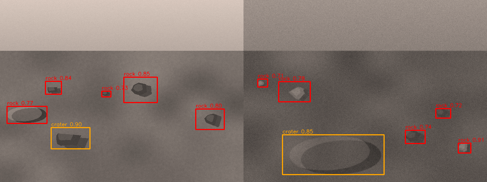

# urc_rock_detection

**SEDS Pakistan – 72-Hour Crucible, Task 05:** OpenCV Boulder & Rock Detection Node
(`SEDS-TASK-ROV-SRILANKA-011`, Pod 3A, Planetary Rover Squad) – candidate: Urwa Eman.

A ROS 2 (Humble) Python node that finds rocks/boulders and craters in the rover camera image using
**colour (local-contrast) and contour segmentation with OpenCV**, converts them to ground-plane hazard
locations, and publishes them so the **Nav2 local costmap** can mark them as obstacles.



## Contents

```
urc_rock_detection/
  urc_rock_detection/detector.py          OpenCV detector + temporal tracker (no ROS imports)
  urc_rock_detection/projection.py        pixel -> ground projection, hazard footprints, PointCloud2 payload
  urc_rock_detection/image_utils.py       sensor_msgs/Image <-> numpy (no cv_bridge)
  urc_rock_detection/rock_detection_node.py   the ROS 2 node
  urc_rock_detection/boxes.py             Detection -> DetectionBoundingBox fields (clamped, unsigned; no ROS)
  urc_rock_detection/dummy_source.py      dummy camera scenes + exact ground truth (no ROS)
  urc_rock_detection/fake_camera_node.py  fake rover camera: publishes dummy frames + CameraInfo
  urc_rock_detection/make_dummy_dataset.py   writes a labelled image folder for `evaluate images`
  optional/urc_msgs/                      buildable wrapper of the unchanged DetectionBoundingBox.msg (COLCON_IGNORE by default)
  urc_rock_detection/synthetic.py         synthetic terrain generator with ground truth
  urc_rock_detection/evaluate.py          detection-rate evaluator (synthetic / image folder / rosbag2)
  config/rock_detection.yaml              node parameters
  config/nav2_local_costmap_hazard_layer.yaml   Nav2 snippet that consumes the output
  launch/rock_detection.launch.py
  test/                                   43 unit tests
```

Dependencies: `rclpy`, `sensor_msgs`, `geometry_msgs`, `std_msgs`, `python3-opencv`, `python3-numpy`
(all standard ROS 2 Humble / Ubuntu packages – **no non-standard dependencies, no cv_bridge**).
The `urc_msgs/DetectionBoundingBox` output is **optional**: it is published when `urc_msgs` is built in the workspace
(see `optional/urc_msgs/`), otherwise the node logs one warning and runs without it.

## Build and run

```bash
cd ~/ros2_ws/src && cp -r /path/to/urc_rock_detection .
cd ~/ros2_ws && colcon build --packages-select urc_rock_detection && source install/setup.bash

ros2 launch urc_rock_detection rock_detection.launch.py \
     image_topic:=/camera/image_raw camera_info_topic:=/camera/camera_info
```

| Direction | Topic (under `/rock_detection_node/`) | Type | Meaning |
|---|---|---|---|
| in | `image_topic` | `sensor_msgs/Image` | camera frames (bgr8, rgb8, bgra8, rgba8, mono8, mono16, 16UC1, 32FC1) |
| in | `camera_info_topic` | `sensor_msgs/CameraInfo` | intrinsics (optional; `hfov_deg` is the fallback) |
| out | `hazard_points` | `sensor_msgs/PointCloud2` | XYZ ground points of every hazard (+ inflation) in `base_link` → **Nav2 obstacle layer** |
| out | `hazards` | `geometry_msgs/PoseArray` | hazard centres (RViz) |
| out | `detections` | `std_msgs/String` | JSON: label, confidence, bbox, x, y, rx, ry |
| out | `debug_image` | `sensor_msgs/Image` | annotated frame (only when subscribed) |
| out | `detection_boxes` | `urc_msgs/DetectionBoundingBox` | one message per hazard: class_name, confidence, image size, x_min/y_min/x_max/y_max (only if `urc_msgs` is built) |

To feed Nav2, merge `config/nav2_local_costmap_hazard_layer.yaml` into your Nav2 params. An **empty cloud is
published when nothing is visible**, so the costmap clears old hazards (`clearing: True`).

## How it works

1. Gray conversion, crop the sky (top `horizon_frac`) and the rover body (bottom strip), CLAHE + blur.
2. Local contrast = image − large-sigma Gaussian background → dark (shadows, dark rocks) and bright
   (lit faces, crater rims) masks → morphological open/close.
3. Contours filtered by area, solidity, aspect ratio and **edge support** (rejects soft terrain blotches).
4. A second large-scale pass joins the dark and bright inner walls of big depressions into one **crater**.
5. NMS, then a small IoU tracker (`min_hits: 2`) removes single-frame false positives.
6. Each detection is projected onto the flat ground using the camera height/pitch/intrinsics:
   rocks use their bottom edge (ground contact), craters use all four box-edge midpoints.

## Verification

### 1. Unit tests (no ROS needed)
```bash
python3 -m unittest discover -s test -t . -v        # 43 tests
python3 -m urc_rock_detection.evaluate synthetic --n 60     # prints detection rate, exit 0 if >= 85 %
```
Measured on 60 generated scenes per level (ground truth known):

| Scene difficulty | Detection rate (recall) | Precision |
|---|---|---|
| easy   | 89.3 % | 94.7 % |
| medium | 95.0 % | 97.3 % |
| hard (very low contrast, heavy blur/noise) | 75.3 % | 97.4 % |

The synthetic scenes are only an approximation of real terrain, and the thresholds were tuned on them.

### 2. Bag-style test with a dummy camera (the team's recorded bag was not in the resource package)
The task asks for a test against a recorded bag of rock hazards with a detection rate above 85 %. No bag file exists in the
Crucible resource package, so a **dummy camera** stands in: it publishes synthetic rock/crater frames with exact ground truth.
These scenes come from the same generator the detector was tuned on, so the numbers are **optimistic** and are not a
substitute for real footage.

**(a) Labelled image folder (no ROS needed):**
```bash
python3 -m urc_rock_detection.make_dummy_dataset --out ~/rock_dummy --n 40
python3 -m urc_rock_detection.evaluate images --dir ~/rock_dummy --labels ~/rock_dummy/labels.json
```
Result on 40 dummy scenes (easy + medium): GT = 240, TP = 218, FP = 9, FN = 22 -> **detection rate 90.8 %**, precision 96.0 % (PASS vs 85 %).
On deliberately hard scenes (very low contrast, heavy blur/noise) the rate is about 70 % (FAIL), see Known limits.

**(b) Through ROS 2 with a recorded bag:**
```bash
# terminal 1: record
ros2 bag record -o dummy_rock_bag /camera/image_raw
# terminal 2 (start after terminal 1 is recording; it waits 3 s before sending 200 frames)
ros2 run urc_rock_detection fake_camera_node --ros-args -p labels_out:=$HOME/dummy_labels.json
# when it logs "done: published 200 frames", stop terminal 1 with Ctrl+C, then:
ros2 run urc_rock_detection evaluate bag --bag dummy_rock_bag --topic /camera/image_raw --labels $HOME/dummy_labels.json
```
The `frames=` line printed by `evaluate bag` must equal the frames the fake camera published (200); if not, the bag missed frames
and the label indices no longer line up, so record again.

**(c) Live check of the node:**
```bash
ros2 launch urc_rock_detection rock_detection.launch.py image_topic:=/camera/image_raw camera_info_topic:=/camera/camera_info
ros2 run urc_rock_detection fake_camera_node
ros2 topic echo /rock_detection_node/detection_boxes     # needs urc_msgs, see below
rviz2   # PointCloud2 /rock_detection_node/hazard_points, Image /rock_detection_node/debug_image
```

**With the team's real bag** (if the reviewer provides one), use the same `evaluate bag` command and label about 30-50 frames by hand as
`{"0": [[x, y, w, h], ...], "12": [[...]]}`. If the rate is below 85 %, tune in this order: `dark_thresh`/`bright_thresh` (lower = more
sensitive), `min_edge_frac`, `min_area_frac`, `horizon_frac`, `min_hits` (1 disables confirmation).
Set `camera_height_m` / `camera_pitch_deg` to the real mounting, otherwise positions will be off.

### 3. DetectionBoundingBox output
`urc_msgs/msg/DetectionBoundingBox.msg` (header, class_name, confidence, image_width, image_height, x_min, y_min, x_max, y_max) is
published on `/rock_detection_node/detection_boxes`, one message per confirmed hazard, with the image's header. Pixel coordinates are
clamped inside the image and unsigned (`x_min <= x_max`, `y_min <= y_max`). The resource package only contains the `.msg` file, so if
the real `urc_msgs` is not in your workspace, build the wrapper in `optional/urc_msgs/` (see its README); otherwise the node prints one warning and
keeps working without this topic. Set `publish_urc_boxes:=false` to disable it.

## Cases handled

* No / corrupt / unsupported image, tiny image, constant image, NaN or 16-bit data → no crash, no hazards
* Padded image rows (`step`), RGB/BGR/RGBA/mono encodings, any resolution (internally scaled to 640 px)
* Sky, horizon and rover-body regions ignored; pure noise and smooth gradients give no hazards
* Rocks that are dark or bright, with or without shadow; craters with dark/bright walls
* Missing `camera_info` (falls back to `hfov_deg`); resolution changes; rays above the horizon / out of range dropped
* Stale or too-fast frames dropped (`max_image_age_s`, `max_process_hz`); detector errors are caught and logged
* Live re-tuning with `ros2 param set`

## Known limits

* Ground projection assumes flat ground; rock *size* is estimated from its ground footprint width.
* Rock vs crater labelling is a heuristic (size + wall pattern); both are published as hazards either way.
* Not validated on real rover footage; the bag-style test above uses dummy scenes (optimistic). Very low-contrast scenes reach only about 70-75 %.
